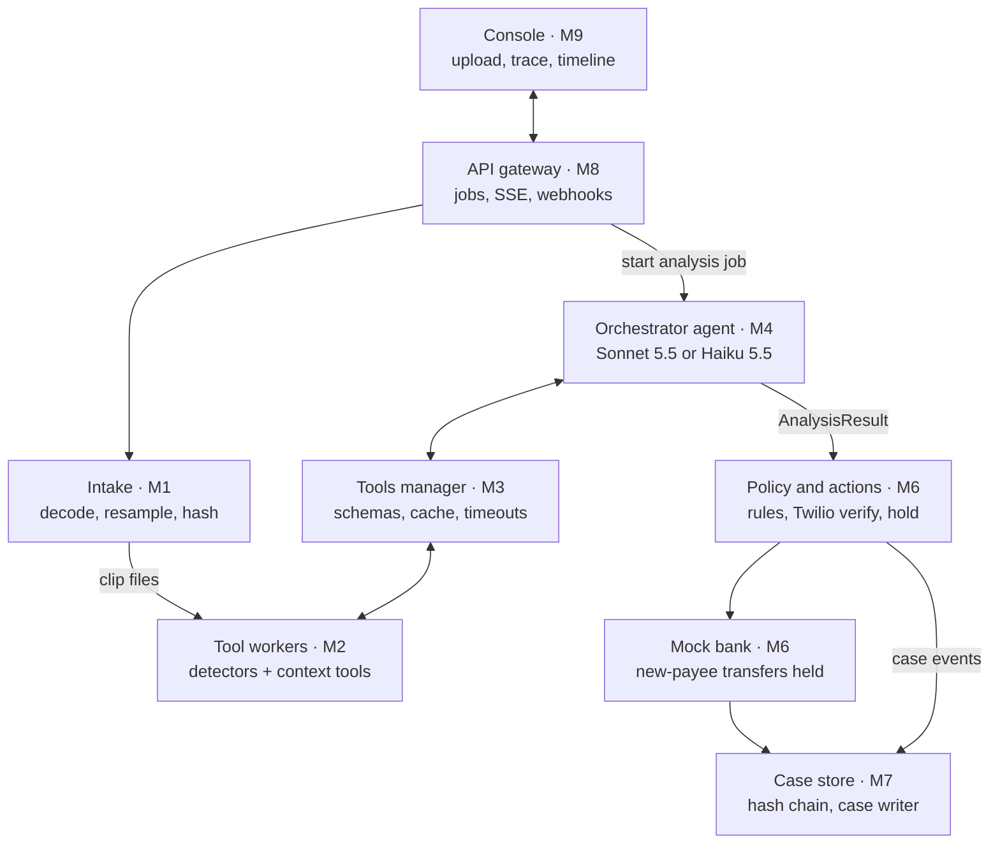

# CallGuard Build Spec: Agentic Mixed-Authenticity Detection + Scam Interrupt

Oct 17, 2026 · @Tanish Rathin Vora

## Overview

CallGuard finds which speaker turns in a call or voicemail are AI-generated, then stops the money from leaving. One orchestrator agent calls specialist audio tools to localize synthetic turns. Plain rules then text the claimed person on their saved number and hold new-payee transfers until a second person approves.

| Item | Decision |
| --- | --- |
| Event | c0mpiled-14, UC Berkeley, one-day build |
| Main track | Regulated industries (YC RFS: Proving You're Human): a credit union's scam interrupt and audit trail |
| Side track | Personal AI use (YC RFS: AI for the Aging Population): the member and caregiver experience |
| Technical claim | An agent that localizes mixed-authenticity audio by speaker turn beats a fixed, no-LLM localizing pipeline (H2) |
| Demo clip | 10 s consented clone of "Jake", then a real teammate as the "lawyer" |
| Not today | Live in-call streaming (stretch), training detectors, native mobile apps |

The demo must show four things:

1. The agent flags only the cloned turn and passes the human turn, with its tool trace visible.
2. The real Jake gets a text on his saved number; his "NO" marks the case contradicted.
3. Grandma's $9,500 wire to a new payee is held until her trusted contact approves or declines.
4. The credit union gets a hash-chained case record and a draft SAR narrative.

## End-to-end workflow

Audio enters through the API, the orchestrator localizes synthetic turns through the tools manager, and deterministic code turns that verdict into a text, a payment hold and a case record. Every analysis mode emits the same `AnalysisResult`, so the policy layer, console and eval harness never care which mode ran.



Only the orchestrator is an LLM agent. The tools manager is its single door to the workers, and everything below the agent is deterministic code that writes to the case store.

1. **Audio in.** Primary: upload a voicemail or recorded call in the console. Stretch: a Twilio number records forwarded calls and posts the recording to the API.
2. **Intake (M1).** ffmpeg decodes to mono, writes a 16 kHz copy for detectors, and keeps the original-rate copy for NISQA. A SHA-256 of the decoded samples becomes `clip_id`; a repeat clip returns cached results.
3. **Analysis job (M8 to M4).** The API starts a job in one of three modes: `baseline` (no LLM), `fixed` (every tool runs, one LLM call) or `adaptive` (the agent picks tools under caps).
4. **Tool calls (M4 to M3 to M2).** The orchestrator calls tools only through the tools manager. It validates arguments, checks the cache, calls the worker and returns a `ToolRecord`. Failures come back as `status="failed"`, never as exceptions.
5. **Verdict (M4).** The orchestrator returns speaker-turn segments labeled `bona_fide`, `synthetic` or `uncertain`, each with tool evidence, plus `mixed`, `composition`, or an abstain reason. The trace streams to the console over SSE.
6. **Claimed identity (M6).** For each synthetic segment, faster-whisper transcribes that segment only, and a matcher looks for a saved contact's name or a relationship word. The transcript never goes back to the orchestrator.
7. **Policy (M6).** Rules map the verdict to actions: verify the claimed contact, hold new-payee transfers, notify the trusted contact.
8. **Verification (M6).** Twilio texts the contact's saved number. The reply webhook moves the case to `VERIFIED` or `CONTRADICTED`, or to `UNREACHABLE` after a timeout.
9. **Circuit breaker (M6).** A new-payee transfer from the member while the case is not `VERIFIED` is `HELD`. Release needs the trusted contact's approval link.
10. **Case record (M7).** Every step appends a hash-chained event. The case writer (Sonnet 5.5) turns the events into an incident summary and a SAR narrative draft.
11. **Console (M9).** Shows the speaker-turn timeline, tool trace, verification status, held transfer and case packet.

## Agents and LLMs

There is one agent: the orchestrator. The only other LLM calls are the case writer and an optional name-matching fallback; everything that listens, decides or acts is deterministic code.

| Component | Kind | Model string | Why this choice |
| --- | --- | --- | --- |
| Orchestrator, adaptive mode | Single agent, native tool use, ReAct loop under caps | `claude-sonnet-5-5` | Multi-step tool selection and reconciling conflicting evidence |
| Orchestrator, fixed mode | One aggregation call over all tool records | `claude-haiku-5-5` | Cheap and reproducible; the first mode built |
| Orchestrator, upper bound | Same harness, eval only | `claude-opus-5-5` | Shows whether a bigger model changes results |
| Cross-provider check | Same harness through an OpenAI-compatible client | An open-weights model served with vLLM or Ollama | The v0.2 rule: test a non-Anthropic model before claiming which orchestrator is best |
| Case writer | One call over structured case events | `claude-sonnet-5-5` | Regulator-readable incident summary and SAR draft |
| Name-matcher fallback | One call, only when string matching fails | `claude-haiku-5-5` | Optional; most demo names match by string |
| Tool workers, tools manager, baseline, policy, verifier, circuit breaker | Deterministic code | None | Reproducible, cacheable, auditable |

Rules every LLM call follows:

- No LLM ever sets a score. Every continuous score comes from a tool output, and the validator checks that each `tool_score` appears in a `ToolRecord` from the trace.
- The orchestrator has no side-effect tools and never sees transcripts or free-text metadata.
- Use the lowest-variance sampling settings the API allows, logged with every run.
- All calls go through one `LLMClient` adapter (Anthropic, OpenAI-compatible, Mock), so swapping models is a config change.

## Tool inventory

The orchestrator sees eight tools, all served by the tools manager; six are required and two are optional. Transcription exists but is only callable by the policy layer.

| Tool | Wraps | Arguments | Returns | Worker |
| --- | --- | --- | --- | --- |
| `get_context` | Silero VAD, pyannote diarization, VoxLingua107 LID, channel analyzer, NISQA | `clip_id` | Speech segments, speaker turns, language + confidence, per-turn bandwidth, clipping and SNR, MOS | context :8103 |
| `score_turns` | AntiDeepfake (A) or XLS-R + SLS (B) | `clip_id`, `detector` | `p_fake` per speaker turn | A :8101, B :8102 |
| `score_windows` | Window scorer over one detector | `clip_id`, `detector`, `start`, `end`, `window_s` in {2, 4, 10}, `hop_s` | Score track inside the range | A :8101, B :8102 |
| `rescore_region` | One detector with long context | `clip_id`, `detector`, `start`, `end`, `context_s` up to 30 | One `p_fake` for the range | A :8101, B :8102 |
| `find_boundaries` | `ruptures` change points over the score track and channel features | `clip_id`, `start`, `end`, `signals[]` | Change points, each with the signal that moved | boundaries :8104 |
| `speaker_consistency` | SpeechBrain ECAPA | `clip_id`, `turn_a`, `turn_b` | Cosine similarity and `same_speaker` | context :8103 |
| `localize` (optional) | CFPRF or MRM frame-level localizer | `clip_id`, `start`, `end` | Frame probabilities summarized into segments | localizer :8105 |
| `separate` (optional) | Demucs | `clip_id` | `clip_id` of the derived speech stem | separation :8106 |
| `transcribe` (policy only) | faster-whisper | `clip_id`, `start`, `end` | Text of one segment | M6 in-process |

Tool facts every implementer needs:

- **Score direction.** Every detector returns `p_fake` in \[0, 1\]. AntiDeepfake's sample code uses index 0 for fake and 1 for real, so `p_fake` is softmax index 0; confirm it on a known fake and a known real clip.
- **Input format.** Detectors take 16 kHz mono. NISQA runs on the original-rate copy.
- **Short turns.** Turns under 1 s get the flag `too_short`; the agent must not label from them alone.
- **Why `find_boundaries` names the signal.** A change in diarization or channel features alone is a speaker change. A change in `p_fake` is an authenticity change. The agent needs to tell them apart.
- **Licenses.** AntiDeepfake and NISQA weights are CC BY-NC-SA 4.0 (non-commercial). pyannote weights are gated on Hugging Face, so accept the terms before the event.

## Stack, repo layout and ports

One monorepo, one directory per module, and every heavy model in its own environment behind HTTP. All backend services run on one rented GPU box sharing `DATA_DIR`; laptops run the web app and the mocks.

- **Main env:** Python 3.11 managed with `uv`; FastAPI, pydantic v2, httpx, `anthropic` SDK, SQLite, pytest, ruff.
- **Worker envs:** one per worker. AntiDeepfake pins Python 3.9.0 and fairseq 0.12.2, so it never shares an env. torch, silero-vad, pyannote.audio, speechbrain, ruptures, faster-whisper, ffmpeg.
- **Frontend:** Vite, React, TypeScript, Tailwind, wavesurfer.js with the regions plugin.
- **Telephony:** Twilio Python SDK; a public tunnel (ngrok or cloudflared) for webhooks.

```
callguard/
  CLAUDE.md                 # rules for every coding subagent (see next sections)
  Makefile                  # make dev, make test-<module>, make eval, make smoke
  contracts/                # M0: models.py, JSON schemas, fixtures/  (lead owns)
  intake/                   # M1
  workers/
    detectors/              # M2A: antideepfake/, xlsr_sls/  (separate envs)
    context/                # M2B: vad, diarization, lid, channel, nisqa, ecapa
    boundaries/             # M2C: window scorer, change points
    localizer/              # M2D (optional): CFPRF or MRM
    separation/             # M2E (optional): Demucs
  tools_manager/            # M3
  orchestrator/             # M4
  baseline_eval/            # M5
  policy_actions/           # M6
  cases/                    # M7
  api/                      # M8
  web/                      # M9
  data/golden/              # G1 to G6 clips + expected.json
  scripts/smoke.sh          # full G3 flow with every mock on
```

| Service | Port | Owner |
| --- | --- | --- |
| API gateway | 8000 | M8 |
| Tools manager | 8100 | M3 |
| AntiDeepfake worker | 8101 | M2A |
| XLS-R + SLS worker | 8102 | M2A |
| Context worker | 8103 | M2B |
| Boundaries worker | 8104 | M2C |
| Localizer worker (optional) | 8105 | M2D |
| Separation worker (optional) | 8106 | M2E |
| Web app | 5173 | M9 |

Environment variables, all in `.env` and never committed: `ANTHROPIC_API_KEY`, `TWILIO_ACCOUNT_SID`, `TWILIO_AUTH_TOKEN`, `TWILIO_FROM`, `TOOLS_URL`, `DATA_DIR`, `MOCK_TOOLS`, `MOCK_LLM`, `MOCK_TWILIO`.

## M0 Shared contracts

These models are the only coupling between modules; write them first, commit fixtures for every one, and change them only through `CONTRACT_CHANGE.md`. The lead owns this directory and finishes it in the first 30 minutes.

```python
# contracts/models.py  (pydantic v2)
from typing import Literal
from pydantic import BaseModel

class ClipMeta(BaseModel):
    clip_id: str                      # sha256 of decoded mono PCM
    duration_s: float
    orig_sr: int
    paths: dict[str, str]             # {"orig": ".../orig.wav", "16k": ".../16k.wav"}
    parent_clip_id: str | None = None # set for derived clips, e.g. a speech stem

class ToolCard(BaseModel):            # served by GET /tools; read by the orchestrator
    name: str
    version: str
    description: str
    args_schema: dict                 # JSON Schema
    values_schema: dict
    known_weaknesses: list[str]

class ToolRecord(BaseModel):
    tool: str
    version: str
    clip_id: str
    params: dict
    status: Literal["ok", "failed", "invalid_input"]
    values: dict                      # shape given by the tool card
    validity: dict                    # {"min_duration_s": 1.0, "sample_rate": 16000}
    flags: list[str] = []             # "too_short", "low_bandwidth", "clipped"
    runtime_ms: int
    error: str | None = None

class Turn(BaseModel):
    idx: int
    speaker: str
    start: float
    end: float

class Evidence(BaseModel):
    tool: str
    field: str
    value: float | str | bool

class Segment(BaseModel):
    start: float
    end: float
    speaker: str | None
    label: Literal["bona_fide", "synthetic", "uncertain"]
    tool_score: float | None          # p_fake from a ToolRecord in the trace; used for EER
    evidence: list[Evidence]

class AnalysisResult(BaseModel):
    clip_id: str
    system: Literal["baseline", "fixed", "adaptive"]
    model: str | None
    segments: list[Segment]
    mixed: bool
    composition: Literal["none", "speaker_handoff", "splice", "overlay"]
    abstain: str | None = None        # reason, e.g. "budget_exceeded", "tool_failed:score_turns"
    summary: str                      # at most 3 sentences, cites tools by name
    trace_id: str
    usage: dict                       # tokens, tool_calls, seconds, usd

class TraceEvent(BaseModel):          # streamed over SSE
    trace_id: str
    seq: int
    kind: Literal["tool_call", "tool_result", "llm", "final", "error"]
    payload: dict

class Action(BaseModel):
    type: Literal["verify_contact", "hold_new_payee", "notify_trusted_contact"]
    case_id: str
    target: str | None                # contact id, never a raw phone number from the call
    reason: str

class CaseEvent(BaseModel):
    case_id: str
    seq: int
    ts: str                           # ISO 8601 UTC
    type: str                         # clip_ingested, analysis_done, action, verification, transfer_*
    payload: dict
    prev_hash: str                    # 64 zeros for seq 0
    hash: str                         # sha256(prev_hash + canonical_json(case_id, seq, ts, type, payload))
```

State values shared by M6, M7, M8 and M9:

- **Case:** `OPEN`, `VERIFYING`, `VERIFIED`, `CONTRADICTED`, `UNREACHABLE`.
- **Transfer:** `PENDING`, `HELD`, `RELEASED`, `DECLINED`.

Fixtures in `contracts/fixtures/`: one `ToolRecord` per tool for golden clip G3, one `AnalysisResult` per golden clip, one `TraceEvent` stream for G3, and one finished case for G3. Every module's mock reads these files.

## How we code fast without losing quality

Speed comes from never waiting on another module; quality comes from shared golden clips and hard acceptance tests. Contracts first, a mock for every module, the same six golden clips as every module's tests, and four integration checkpoints.

**Root `CLAUDE.md`, given to every coding subagent:**

```markdown
# Rules for every coding subagent
1. Read contracts/models.py, this module's README and its spec section before writing code.
2. Edit only files inside your module directory. Need a contract change? Write it in CONTRACT_CHANGE.md and stop.
3. Ship a mock: the module must run with MOCK_*=1 from contracts/fixtures, with no GPU and no network.
4. Never raise across a module boundary. Return ToolRecord(status="failed") or an error TraceEvent.
5. Tests live in <module>/tests and use data/golden. `make test-<module>` must pass before you hand back.
6. Typed Python, pydantic at every boundary, ruff clean. TypeScript strict in web/.
7. Log JSON lines to stdout, always with trace_id or case_id.
8. No secrets in code; read env vars.
9. Hand back: what you built, how to run it, what is still mocked, what failed.
```

**Golden clips (`data/golden/`).** Record these in the first 30 minutes. Pass every clip through G.711 at 8 kHz after mixing, as a real call would be. Keep written consent for every cloned voice.

| ID | Content | Expected result |
| --- | --- | --- |
| G1 | One real speaker, 30 s | All `bona_fide`, `mixed=false` |
| G2 | One cloned speaker, 30 s | All `synthetic`, `mixed=false` |
| G3 | 10 s cloned "Jake", then 40 s real "lawyer" (the demo clip) | Turn 0 `synthetic`, turn 1 `bona_fide`, `speaker_handoff` |
| G4 | Two real speakers handing off | All `bona_fide`; catches speaker-change false alarms |
| G5 | One real speaker with a 3 s cloned insert, crossfaded | Insert `synthetic`, `splice` |
| G6 | G3 with a music bed at 10 dB SNR | Same as G3, `overlay` flag allowed |

**Speed rules.**

- Run every worker once on G1 to G6 and commit the `ToolRecord`s as fixtures. The orchestrator, policy and frontend then iterate with no GPU in the loop.
- Cache tool outputs by `clip_id`, tool, version and parameters; never rerun a detector on the same input.
- If a model will not load within 20 minutes, drop it and continue with the rest (v0.2 guardrail).
- Tune prompts and thresholds on a dev split; report only on the held-out split.

**Subagent prompt template.** Paste one module section of this doc where it says `<SECTION>`.

```text
You are implementing <MODULE> for CallGuard.
Read first: CLAUDE.md, contracts/models.py, <module>/README.md, and the spec section below.
Build exactly the tasks in the section. Develop against MOCK_*=1 and contracts/fixtures.
Done when every acceptance check in the section passes via `make test-<module>`.
Do not touch anything outside <module>/.
Hand back: a 5-line summary, the run command, what is mocked, known gaps.

<SECTION>
```

**Definition of done for any module:** acceptance checks pass, the mock runs with no GPU or network, the README states run and test commands, and ruff is clean.

## M1 Intake and clip store

Turns any uploaded audio into a hashed, normalized clip that every other module reads by `clip_id`. Owns `intake/`. About 45 minutes; no dependencies beyond contracts.

**Interface (Python, imported by M8 and M2E):**

```python
ingest(src: Path | bytes, filename: str) -> ClipMeta
get(clip_id: str) -> ClipMeta
derive(parent_id: str, samples: np.ndarray, sr: int, kind: str) -> ClipMeta   # e.g. kind="speech_stem"
```

**Storage:** `data/clips/<clip_id>/orig.wav`, `16k.wav`, `meta.json`.

**Tasks:**

1. Decode with ffmpeg to mono float32 at the original rate; accept wav, mp3, m4a, ogg, opus and webm.
2. Hash SHA-256 over the decoded PCM16 bytes, so the same audio in two containers gets one `clip_id`.
3. If the clip exists, return its `ClipMeta` without rewriting files.
4. Write `orig.wav` at the original rate and `16k.wav` resampled with ffmpeg's soxr resampler.
5. Reject clips under 1 s or over 10 minutes with a clear error.

**Acceptance checks:**

- [ ] The same file uploaded twice returns the same `clip_id` and no new files.
- [ ] One recording saved as wav and as mp3 at high bitrate decodes to the same duration within 50 ms.
- [ ] G1 to G6 all ingest, and `16k.wav` is 16 kHz mono.
- [ ] A 0.5 s clip is rejected with a readable error.

## M2 Tool workers

Each worker is a small FastAPI service in its own environment that turns audio into numbers; it knows nothing about agents, cases or other workers except where noted. Owns `workers/`. Split into five parts so up to five subagents can build in parallel.

**Worker contract (all parts):**

- `GET /health` returns `{"ok": true, "version": "..."}`.
- `GET /cards` returns the `ToolCard`s for the operations this worker serves.
- `POST /<op>` takes `{"clip_id", "path_16k", "path_orig", "params"}` and returns `{"values", "version", "flags", "runtime_ms"}`. The tools manager wraps this into a `ToolRecord`.
- On any error, return HTTP 200 with `{"error": "..."}`. Never crash the process.

### M2A Detectors (ports 8101 and 8102)

Two services with identical operations: AntiDeepfake on 8101 and XLS-R + SLS on 8102.

1. Load the checkpoint named in config. AntiDeepfake defaults to the v0.2 choice (`nii-yamagishilab/wav2vec-large-anti-deepfake-nda`); the XLS-R variants from the same collection are a config swap. XLS-R + SLS uses the SLSforADD code with the XLS-R 300M base.
2. `/turns`: score each turn as one input, batched on GPU. Turns over 30 s are split into 30 s chunks and logits are averaged.
3. `/windows`: score a range with `window_s` and `hop_s`; return `[{t_start, t_end, p_fake}]`.
4. `/region`: score exactly `[start, end]` as one input, up to 30 s.
5. Normalize to `p_fake` and also return raw logits. Flag inputs under 1 s as `too_short`.

- [ ] Index order confirmed on one known fake and one known real clip.
- [ ] Mean `p_fake` on G2 is higher than on G1 for both detectors.
- [ ] `/turns` on G3 returns two scores in under 5 s on GPU.

### M2B Context (port 8103)

One service for everything that describes the audio rather than judging it.

1. `/context` returns, in one call:
   1. Silero VAD speech segments and the speech ratio.
   2. pyannote diarization turns, with min 1 and max 3 speakers, merging same-speaker gaps under 0.3 s.
   3. VoxLingua107 language and confidence on the longest turn.
   4. Per-turn channel features: bandwidth as the median 99% spectral rolloff, clipping fraction at |x| of 0.99 or more, and SNR from VAD speech versus non-speech energy.
   5. NISQA MOS on the original-rate copy.
2. `/speaker_consistency`: ECAPA embeddings per turn, cached; return cosine and `same_speaker` at a threshold tuned on G4.

- [ ] G4 returns two speakers and G1 returns one.
- [ ] G3 turn boundaries land within 0.5 s of the manifest.
- [ ] A clip low-passed at 3.4 kHz gets the `low_bandwidth` flag.

### M2C Boundaries (port 8104)

Finds where something changes and reports what changed.

1. `/boundaries` takes `start`, `end` and `signals`, any of `p_fake_A`, `p_fake_B`, `bandwidth`, `loudness`, `snr`.
2. Build each signal as a frame series at a 0.5 s hop. Get `p_fake` series from the detector workers' `/windows` with 2 s windows, and compute the channel series locally.
3. Z-score each series and run `ruptures` Pelt with an RBF cost. Tune the penalty on G3 and G5 only.
4. For each change point, return the time, each signal's left-versus-right mean difference, and `moved`, the signal with the largest change.

- [ ] G5 returns a `p_fake` change point within 0.5 s of each insert edge.
- [ ] G4 returns a change point whose `moved` is a channel signal, not `p_fake`.
- [ ] G1 returns no change point with `moved` set to `p_fake`.

### M2D Localizer (port 8105, optional)

1. Wrap CFPRF (`github.com/ItzJuny/CFPRF`) or MRM (`github.com/hieuthi/MultiResoModel-Simple`).
2. `/localize` returns frame probabilities and segments where the probability is above 0.5.
3. Its tool card must state that it was trained on PartialSpoof and is weak out of domain.

- [ ] G5 returns a segment overlapping the insert.

### M2E Separation (port 8106, optional)

1. Run Demucs `htdemucs` and keep the vocals stem.
2. Save it through M1 `derive()` and return the new `clip_id`.

- [ ] G6 speech stem has a higher NISQA MOS than the mixed clip.

## M3 Tools manager

The single door between the orchestrator and every worker: it validates, caches, times out and normalizes, so no other module ever talks to a worker directly. Owns `tools_manager/`, a FastAPI service on port 8100. About 90 minutes; depends on contracts and M1 only.

**Endpoints:**

| Method and path | Returns | Used by |
| --- | --- | --- |
| `GET /tools` | `ToolCard[]` for the eight orchestrator tools | M4 prompt builder |
| `GET /tools/anthropic` | Tool definitions in Anthropic tool-use format, generated from the cards | M4 adaptive loop |
| `POST /tools/{name}` with `{clip_id, params, trace_id}` | One `ToolRecord` | M4, M5 baseline |
| `GET /budget/{trace_id}` | Tool calls and seconds used so far | M4 cap checks |

**Tasks:**

1. Keep a registry mapping each tool name to its worker URL, operation and version. `get_context` fans out to the context worker in one call.
2. Validate `params` against the card's `args_schema`. A bad argument returns `status="invalid_input"` with the validation message, so the agent can correct itself.
3. Resolve `clip_id` to file paths through M1 `get()`.
4. Cache on disk, keyed by the SHA-256 of `clip_id`, tool, version and canonical JSON params. A version bump invalidates only that tool.
5. Time out each call at 60 s and retry once on a connection error. Any worker failure becomes `status="failed"`.
6. Count calls and seconds per `trace_id`.
7. With `MOCK_TOOLS=1`, serve `ToolRecord`s from `contracts/fixtures/`, keyed by clip and tool.

**Acceptance checks:**

- [ ] A worker killed mid-run yields a `failed` record and the caller keeps going.
- [ ] A repeat call returns from cache in under 10 ms.
- [ ] Bumping one tool's version re-runs only that tool.
- [ ] `GET /tools/anthropic` output is accepted unchanged by the Anthropic SDK.
- [ ] With `MOCK_TOOLS=1`, all G3 tools return fixtures with no worker running.

## M4 Orchestrator agent

One LLM agent reads tool records, picks further tools within caps, and returns a validated `AnalysisResult`; it has no side-effect tools and never sees transcripts. Owns `orchestrator/`.  develops entirely against `MOCK_TOOLS=1` until checkpoint I2.

**Interface:**

```python
async def run(clip_id: str, mode: Literal["fixed", "adaptive"], model: str,
              caps: Caps) -> AsyncIterator[TraceEvent]   # last event: kind="final", payload=AnalysisResult
```

**Files:** `llm_client.py` (Anthropic, OpenAI-compatible and Mock adapters), `fixed.py`, `adaptive.py`, `prompt.md`, `validate.py`, `caps.py`.

**Fixed mode (build first, default `claude-haiku-5-5`):**

1. `get_context`.
2. `score_turns` with A and with B, in parallel.
3. `score_windows` with B, 4 s windows and a 1 s hop, inside every turn.
4. `find_boundaries` over the whole clip with all signals.
5. `speaker_consistency` for every pair of turns that diarization gave the same label.
6. One LLM call with every record, returning `AnalysisResult` JSON.

**Adaptive mode (default `claude-sonnet-5-5`):**

1. Always run `get_context` and `score_turns` (A and B) first, before the model is called.
2. Then a native tool-use loop using `GET /tools/anthropic`, with parallel tool calls allowed.
3. Default caps: 12 steps, 20 tool calls, 90 s and $0.25 per clip, tuned on the dev split. A cap breach ends with `abstain="budget_exceeded"`, never a crash.

**System prompt skeleton (`prompt.md`):**

```text
You are an evidence aggregator for speech authenticity. Tools do the listening; you decide which
tools to run and reconcile their outputs. You never hear audio.

Task: label each speaker turn bona_fide, synthetic or uncertain, then refine segment edges.
Rules:
- Label by speaker turn first. Use find_boundaries to place edges; trust a change point whose
  `moved` signal is p_fake, not one where only channel features moved.
- A speaker change alone is never evidence of synthesis.
- Every segment cites the tool and field it relies on. Never invent a number.
- If detectors A and B disagree on a turn, call rescore_region on it. Still disagreeing -> uncertain.
- Turns flagged too_short cannot be labeled synthetic on their own score.
- If a tool on the critical path failed, abstain and name it.
- Output only JSON matching the AnalysisResult schema.

Tool cards: {tool_cards}
```

**Validation (`validate.py`):**

- Parse with pydantic. On failure, retry once with the error message; a second failure returns `abstain="invalid_output"`.
- Reject any `tool_score` that does not appear in a `ToolRecord` from this trace.
- Reject segments that overlap or fall outside the clip.
- Log tokens, latency and dollar cost on every run.

**Acceptance checks:**

- [ ] Fixed mode returns valid JSON for G1 to G6 from fixtures.
- [ ] G3 labels turn 0 `synthetic` and turn 1 `bona_fide` with `speaker_handoff`.
- [ ] G4 returns no `synthetic` segment.
- [ ] A cap of 2 tool calls returns `abstain="budget_exceeded"`.
- [ ] A fixture where `score_turns` failed returns an abstain naming that tool.
- [ ] Swapping `model` to an OpenAI-compatible endpoint runs with no code change.

## M5 Baseline and eval harness

This module proves or disproves the technical claim: it builds the mixed test set, runs a no-LLM localizing baseline, and produces one comparison table from one command. Owns `baseline_eval/`.  uses M3 for tools and M4 for the agent modes.

### Baseline (no LLM)

The baseline is the comparator for H2, so it must localize too.

1. `get_context`, then `score_turns` with A and B; average the two `p_fake` values per turn.
2. Label a turn `synthetic` above threshold τ, tuned on the dev split.
3. Inside each turn, run `find_boundaries`. Where `moved` is `p_fake` with a change of 0.4 or more, split the turn and label each side by its window mean.
4. Emit `AnalysisResult` with `system="baseline"`, so eval treats all systems the same way.

### Mixed test-set builder (`mixset.py`)

The builder must not hand the agent a shortcut: real scam calls have no hard cuts.

1. **Sources:** consented teammate recordings, clones of the same teammates from an open voice-cloning TTS, and optional public real speech (check each license).
2. **About 100 clips:** 40 clone-to-human handoffs, 20 real-to-real handoffs, 15 single real, 15 single cloned, 10 same-speaker cloned inserts.
3. **Splicing:** match loudness with `pyloudnorm` and crossfade every join over 50 ms.
4. **Channel:** after mixing, pass the whole clip through one codec: G.711 μ-law at 8 kHz or Opus at 16 kbps, both via ffmpeg.
5. **Manifest:** JSONL with `clip`, `codec`, `scenario` and `segments[{start, end, speaker, label}]`.
6. **Split:** 30% dev for tuning τ, penalties and prompts; 70% held out for reporting.

### Datasets

| Set | Role | Caveat |
| --- | --- | --- |
| Own mixed set | Main result; matches the product | Synthetic mixes are simpler than real calls |
| LlamaPartialSpoof subset | Out-of-domain partial and full fakes, plus bona fide | Download size; subsample |
| PartialSpoof subset | In-domain sanity check | Built on ASVspoof 2019 LA, which overlaps AntiDeepfake's post-training data |
| DFToolBench-A-500 | Smoke test of tool use | Clips are about 2 s; overlaps detector training corpora |

### Metrics and comparators

- **Systems:** A alone (clip level), B alone, baseline, fixed (`claude-haiku-5-5`), adaptive (`claude-sonnet-5-5`), and adaptive with one non-Anthropic model.
- **Metrics:** utterance EER (score = max segment `tool_score`), segment EER at 160 ms and 640 ms, per-turn accuracy, boundary F1 at 0.5 s tolerance, abstain rate, tool calls, seconds and dollars per clip.
- **Statistics:** 95% bootstrap intervals from 1,000 resamples on every number.

**Acceptance checks:**

- [ ] `make eval` regenerates `results/table.md` and `results/results.json` from cached tool outputs in one command.
- [ ] A manifest check confirms every segment label matches the audio it points to.
- [ ] A plain splice detector (a change point on loudness alone) scores near chance on the crossfaded set; otherwise the set has a shortcut.

## M6 Policy and actions

Plain code turns a verdict into outcomes: a text to the real person, a held transfer, and a trusted-contact alert. No LLM decides anything here. Owns `policy_actions/`.  develops against the G3 `AnalysisResult` fixture with `MOCK_TWILIO=1`.

**Files:** `claim.py`, `rules.yaml`, `engine.py`, `verifier.py`, `breaker.py`, `contacts.yaml`.

**Claimed identity (`claim.py`):**

1. For each `synthetic` segment, run faster-whisper on that segment only.
2. Match saved contact names and relationship words ("grandma", "it's me", "your grandson") from `contacts.yaml` with fuzzy string matching.
3. No match: call the `claude-haiku-5-5` fallback with the transcript as quoted data and the contact list as options. It may only return a contact id or `unknown`.

**Rules (`rules.yaml`), evaluated top to bottom, first match wins:**

```yaml
- id: clone_claims_contact
  when: {any_segment: synthetic, claimed_contact: known}
  do: [verify_contact, hold_new_payee, notify_trusted_contact]
- id: clone_unknown_identity
  when: {any_segment: synthetic, claimed_contact: unknown}
  do: [hold_new_payee, notify_trusted_contact]
- id: analysis_abstained
  when: {abstain: true}
  do: [hold_new_payee]
- id: all_bona_fide
  when: {all_segments: bona_fide}
  do: []
```

**State machine (`breaker.py`):**

```text
Case:      OPEN -> VERIFYING(contact) -> VERIFIED      (reply YES)
                                      -> CONTRADICTED  (reply NO)
                                      -> UNREACHABLE   (no reply in 120 s)
Transfer:  new payee while case is not VERIFIED -> HELD
           HELD -> RELEASED  (trusted contact approves, or case becomes VERIFIED)
           HELD -> DECLINED  (trusted contact declines)
```

**Verifier (`verifier.py`):**

- Text the contact's saved number: "Hi Jake, someone is calling Grandma with your voice and asking for money. Reply YES if it's really you, NO if not."
- The inbound webhook checks the `X-Twilio-Signature` header, then parses YES or NO.
- Never dial or text a number spoken on the call or sent as caller metadata.
- Twilio trial accounts only text verified numbers, so verify every teammate's phone before the build starts.
- With `MOCK_TWILIO=1`, replies come from `POST /dev/simulate-reply`.

**Acceptance checks:**

- [ ] G3 produces `verify_contact` to Jake, `hold_new_payee` and `notify_trusted_contact`.
- [ ] A NO reply moves the case to `CONTRADICTED`; no reply in 120 s gives `UNREACHABLE`.
- [ ] A $9,500 transfer to a new payee is `HELD`; approve gives `RELEASED`, decline gives `DECLINED`.
- [ ] G1 produces no actions and transfers go through.
- [ ] Every state change appends a `CaseEvent` through M7.

## M7 Case store and case writer

The regulated-track deliverable: an append-only, tamper-evident record of what was claimed, what verification returned and what was blocked, plus a draft SAR narrative a BSA officer can edit. Owns `cases/`. ; depends on contracts only.

**Interface:**

```python
open_case(member_id: str, clip_id: str) -> str                 # returns case_id
append(case_id: str, type: str, payload: dict) -> CaseEvent
get_case(case_id: str) -> tuple[str, list[CaseEvent]]           # state, events
verify_chain(case_id: str) -> tuple[bool, int | None]           # ok, first bad seq
write_packet(case_id: str) -> dict                              # summary, timeline, evidence, sar_draft
```

**Tasks:**

1. SQLite tables `cases(id, member_id, clip_id, state, created_at)` and `events(case_id, seq, ts, type, payload_json, prev_hash, hash)`, insert-only.
2. Mirror each event to `data/cases/<case_id>.jsonl`.
3. Compute `hash = sha256(prev_hash + canonical_json(case_id, seq, ts, type, payload))`; `prev_hash` for seq 0 is 64 zeros.
4. Case writer: one `claude-sonnet-5-5` call over the structured events, with any transcript text passed as quoted data. It returns an incident summary, a timeline, an evidence table citing tool names, and a SAR narrative draft covering who, what, when, where, why and how.
5. Mark the narrative "DRAFT for BSA officer review" and reference FinCEN alert FIN-2024-Alert004 on deepfake fraud.
6. Export the packet as JSON and Markdown; PDF is optional.

**Acceptance checks:**

- [ ] Editing one stored event makes `verify_chain` fail at that seq.
- [ ] The G3 demo case produces a packet in under 30 s.
- [ ] Every number in the packet's evidence table appears in a case event.

## M8 API gateway

The glue: one FastAPI app on port 8000 that wires intake, orchestrator, policy, cases and the mock bank behind REST, SSE and Twilio webhooks. Owns `api/`.  built by the lead alongside contracts; every route works with all mocks on.

| Method and path | Does | Calls |
| --- | --- | --- |
| `POST /clips` (multipart) | Ingests audio, returns `ClipMeta` | M1 |
| `POST /analyze` with `{clip_id, mode, model}` | Starts a job; `mode` is `baseline`, `fixed` or `adaptive` | M4 or M5 baseline |
| `GET /analyze/{job_id}/stream` | SSE stream of `TraceEvent`s | M4 |
| `GET /analyze/{job_id}` | Final `AnalysisResult` | M4 |
| `POST /cases/from-analysis` with `{job_id, member_id}` | Opens a case and runs policy | M6, M7 |
| `GET /cases/{case_id}` | State, events and chain status | M7 |
| `GET /cases/{case_id}/packet` | Incident packet and SAR draft | M7 |
| `POST /bank/transfers` with `{member_id, payee, amount, new_payee}` | Creates a transfer; returns `PENDING` or `HELD` | M6 breaker |
| `POST /bank/transfers/{id}/approve` or `/decline` with `{token}` | Second key for a held transfer | M6 breaker |
| `POST /twilio/sms` | Verification replies, signature checked | M6 verifier |
| `POST /twilio/recording` (stretch) | Ingests a forwarded-call recording and starts a job | M1, M4 |
| `POST /dev/simulate-reply` (mock only) | Fakes a YES or NO reply | M6 |
| `GET /eval/results` | Serves `results/results.json` | M5 |

**Tasks:**

1. Run jobs as in-process asyncio tasks; persist results in SQLite so a restart does not lose the demo case.
2. Allow CORS from port 5173 and expose the app through a tunnel for Twilio webhooks.
3. Write `scripts/smoke.sh`, which runs the full G3 flow with curl: upload, analyze, case, transfer, simulated NO reply, packet.

**Acceptance checks:**

- [ ] `smoke.sh` passes with `MOCK_TOOLS=1 MOCK_LLM=1 MOCK_TWILIO=1` and no GPU.
- [ ] The SSE stream delivers events in `seq` order and ends with a `final` event.

## M9 Frontend

Four screens that make the demo legible in two minutes: what the agent did, what it found, and what it stopped. Owns `web/` (Vite, React, TypeScript, Tailwind, wavesurfer.js regions).  builds entirely against fixture JSON until checkpoint I1.

| Route | Who sees it | Shows |
| --- | --- | --- |
| `/console` | Judges, the credit union analyst | Clip picker, mode and model selector, live tool trace, speaker-turn timeline, segment table, actions panel, case packet |
| `/bank` | The member ("Grandma"), phone-width | Balance, send money, transfer status in plain words |
| `/approve/:token` | The trusted contact, phone-width | Amount, payee, why it was held, Approve and Decline |
| `/eval` | Judges | The comparison table from `GET /eval/results` |

**Console components:**

1. `ClipPicker`: upload a file or pick G1 to G6.
2. `ModeSelector`: baseline, fixed or adaptive, plus a model dropdown.
3. `TraceFeed`: one row per SSE event with tool name, arguments, a short result and milliseconds; failed calls in a warning colour.
4. `Timeline`: waveform with one region per segment and a speaker lane under it. `synthetic` uses the critical colour, `uncertain` the warning colour, `bona_fide` stays neutral.
5. `SegmentTable`: start, end, speaker, label, `tool_score` and evidence.
6. `ActionsPanel`: verification status per contact, plus mock-only YES and NO buttons.
7. `CasePacket`: summary, SAR draft and a "chain verified" badge.

**Bank screen copy when held:** "Paused for your safety. We could not confirm the caller was Jake. We've asked your trusted contact to approve this transfer."

**Acceptance checks:**

- [ ] The G3 fixture renders turn 0 red and turn 1 neutral on the timeline.
- [ ] The G3 SSE fixture animates in the trace feed in order.
- [ ] The bank flow shows `HELD`, then `RELEASED` or `DECLINED` after the approve page is used.
- [ ] Every screen works at 390 px wide.

## Integration checkpoints, team split and demo script

Four people each drive two or three coding subagents, and the team merges at four fixed checkpoints; anything not working at a checkpoint is cut, not debugged past it.

| Person | Modules | Subagents in parallel |
| --- | --- | --- |
| A: lead and integration | M0, M8, M3 | Tools manager, API gateway |
| B: ML tools (on the GPU box) | M2A, M2B, M2C; M2D and M2E if time | Detectors, context, boundaries |
| C: agent and eval | M4, M5 | Orchestrator, baseline plus test-set builder |
| D: product | M9, M6, M7 | Frontend, policy and actions, case store |

With three people, merge A and D's integration work; with two, one person takes M2 and M5 and the other takes everything else.

**Checkpoints :**

1. **H+0:30, foundations.** Contracts, fixtures, `CLAUDE.md` and golden clips G1 to G6 are committed. Every subagent is launched with its section.
2. **H+2:00, I1 mock end to end.** `smoke.sh` passes and the console renders G3 from mocks, with no GPU.
3. **H+4:00, I2 real tools.** Workers are live behind M3. Fixed mode and the baseline run on G1 to G6, and fixtures are regenerated from real outputs.
4. **H+5:30, I3 full product.** Adaptive mode, real Twilio texts, the held transfer and the case packet all work on G3.
5. **H+6:30, I4 numbers and freeze.** The eval table runs on the held-out set and the LlamaPartialSpoof subset. Feature freeze.
6. **H+7:00 to H+8:00, ship.** Record the demo video, finish the README, submit.

**Cut order if behind:** M2E separation, then M2D localizer, then live Twilio (use simulated replies), then the open-weights comparator, then the PartialSpoof subset. Never cut the G3 demo flow or the adaptive-versus-baseline comparison on your own set.

**Demo script (2 minutes):**

1. **0:00.** One line on the problem: a cloned grandchild opens the call, then a live "lawyer" takes over.
2. **0:15.** Upload G3 in the console and run adaptive mode. The trace streams `get_context`, `score_turns`, `find_boundaries`, `rescore_region`.
3. **0:40.** The timeline shows turn 0 synthetic and turn 1 bona fide, with `speaker_handoff`. Show detector A's whole-clip score beside it to make the point about averaging.
4. **1:00.** Jake's real phone gets the text; he replies NO and the case turns `CONTRADICTED`.
5. **1:15.** On the bank screen, a $9,500 wire to a new payee shows `HELD`. The trusted contact opens the approve link and declines.
6. **1:35.** The case packet: chain verified, evidence citing tools, SAR draft.
7. **1:50.** The eval table: adaptive versus the no-LLM baseline, with intervals. Close by stating that every cloned voice was recorded with consent.